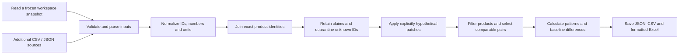

# OneType Adafruit processing engine

A C++ engine that turns Adafruit catalog records and additional structured sources into connected product records, numerical analysis and Excel outputs. The HTML screen is a test console. The engine also runs through JSON requests without a browser.

## Start the prototype

Double-click `start-engine.command`, or run this in Terminal from this folder:

```sh
sh run-engine.sh
```

Open **http://127.0.0.1:4181/**. Leave Terminal running. Control+C stops the engine. The original company-model explorer continues to use port 4180 separately.

The first launch builds the C++17 executable using the system compiler and libcurl. The bundled public data works offline. No account or API key is required. Excel formatting uses Node.js and the spreadsheet toolkit in the Codex bundled runtime on this machine. CSV and JSON outputs use only C++ and remain available if that runtime is unavailable. For another configured runtime, set `ONETYPE_NODE` to its Node executable and `ONETYPE_ARTIFACT_MODULES` to its module directory before launch. Spreadsheet dependencies are not redistributed in the source archive.

## Present a three-minute demo

1. Choose **Real catalog baseline**, then **Run engine**. With the bundled data, 5,587 products yield 5,578 valid shipping-weight/price pairs and Pearson r ≈ 0.7251. Nine virtual products are excluded. Show the full CSV or Excel export rather than relying on the 50-row browser preview.
2. Choose **Pico 2 what-if**, then run. This selects the 91 Raspberry Pi Foundation products and changes only product 6006: catalog price 6.25 → 12.50 and shipping weight 4.1 → 8.2 g. These are hypothetical values. The output shows before/after values and recalculates the association. The original workspace is untouched.
3. Choose **Messy CSV test**, then run. Four hypothetical CSV rows include one exact duplicate, two matched claims and one unknown product ID. The duplicate is suppressed and the unknown identity is quarantined. A 160 MHz claim conflicts with the reviewed 150 MHz manufacturer reference. The manufacturer value remains selected and both claims remain available. The existing Pico 2 SRAM conflict is also retained.
4. Download **Excel workbook**. The workbook includes Results, Products, Evidence, Sources and, when applicable, Unmatched. It records whether the run is a simulation. CSV and complete JSON exports are available beside it.

The supplied `demo/messy-specifications.csv` can also be uploaded through the file picker. Select **Specifications** as its CSV type and **Simulation** as the run type. It contains synthetic claims for testing, not new company observations.

To combine the CSV test and price/weight scenario, use the provided `demo/judge-demo.json` through the CLI, or load the messy preset and add the two hypothetical product changes in the screen.

## How the engine works



`runEngine(workspace, request)` is a pure processing function. It copies its inputs, never writes the real source workspace, and returns the complete result. The server creates a new run folder only after all parsing, validation and calculations succeed. An invalid batch creates no accepted run. Saved inputs include the original baseline so later data changes do not prevent replay.

The model retains a product identity, latest catalog fields, linked source records, selected specifications, all conflicting claims and source capture metadata. It does not merge distinct product variants by name. Unmatched source rows remain reviewable. Uploaded sources cannot mark themselves as reviewed manufacturer references.

The engine accepts catalog, specification, document-reference, observation, inventory, purchase-order and structured communication records. The actual bundled sources are public catalog data and selected technical evidence. Private operational data is not bundled. Document inputs contain references/extracted facts, not arbitrary PDF parsing. Operational records are linked as evidence; private inventory quantities are not confused with public availability counts or summed into an invented inventory total.

## Inputs

Every request is JSON:

```json
{
  "label": "My Adafruit run",
  "base": "workspace",
  "mode": "observed",
  "filters": { "manufacturer": "Raspberry Pi Foundation" },
  "analysis": { "x": "shipping_weight_g", "y": "price_value" },
  "sources": [],
  "patches": []
}
```

- `base`: `workspace` includes the current accepted data. `uploads_only` starts empty, making it possible to analyze a separately uploaded catalog. Its baseline is empty.
- `mode`: `observed` processes the original/user-supplied inputs. `simulation` explicitly labels a hypothetical run. Patches require simulation mode.
- `filters`: exact `manufacturer`, `category_id`, `availability`, plus optional nonnegative `min_price` and `max_price`. The baseline and output apply the same filters independently, so a changed product can enter or leave the selection.
- `analysis`: choose two different metrics from `price_value`, `shipping_weight_g`, `clock_mhz`, `sram_kb`, `flash_mb`, `public_quantity`.
- `sources`: up to 20 source envelopes. Each has `id`, `kind`, `label`, `captured_at`, and either a `records` array or a `csv` string. A source has up to 20,000 rows and a run accepts up to 50,000 additional input rows. See the existing README's import contract for source-specific fields. A source ID cannot be reused in the same loaded model.
- `patches`: entries with `product_id`, `field`, `value`. Supported hypothetical fields are `price_value`, `shipping_weight_g`, `public_quantity`. Values must be nonnegative finite numbers. Quantity must be a whole number up to one billion. Repeated patches to the same canonical identity and field are rejected. The HTML screen edits one product; the JSON API/CLI supports multiple products.

Names, IDs and raw fields retain their source meanings. `0` is a valid price/count. Missing numbers remain unknown. API negative stock sentinel codes are unknown quantities. Shipping kg inputs convert to grams. Memory units are retained as published. Source capture times describe when a record was captured, not necessarily when the underlying business changed.

## Analysis rules

Virtual products and missing/unresolved metric values are excluded. Weight must be positive when it is one of the selected variables. At least 8 pairs and nonzero variation are required for Pearson correlation. Sparse specifications often produce an honest “not calculated” result because only two products currently have the bundled detailed technical facts.

When price is selected, pairs are grouped by catalog source batch and currency field. The largest comparable group is analyzed. Price values from different captures or currencies are not silently pooled. An uploaded partial catalog can therefore move a product into another group and exclude it from the largest group. Use a hypothetical patch to test a value change within the original unit context, or upload a complete catalog under `uploads_only` to analyze that source independently. Missing currency remains unconfirmed.

Other metrics use their normalized units. Manufacturer correlations apply the same rules within each manufacturer group and require at least 8 eligible pairs. Product mix, packaging and outliers affect these cross-sectional associations. They do not establish causation, demand or profitability.

## Saved outputs and replay

Each run creates `runs/<run-id>/` with:

| Output | Contents |
| --- | --- |
| `inputs.json` | Exact workspace snapshot and original request, including raw sources |
| `result.json` | Complete products, evidence, quality results, analysis and changes |
| `products.csv` | All products after the selected filters, including pair inclusion reasons |
| `changes.csv` | Changed fields, original/new values and scenario/import basis |
| `correlations.csv` | Manufacturer cohorts, sample sizes and correlation |
| `evidence.csv` | Linked non-catalog evidence for selected products |
| `sources.csv` | Source provenance and whole-model matching/deduplication counts |
| `unmatched.csv` | Whole-model records that could not be matched exactly |
| `workbook.xlsx` | Generated on demand with all selected products and calculated correlation |

Empty CSV outputs contain no data rows. Raw JSON preserves original text. CSV output prefixes formula-like untrusted strings for safe spreadsheet viewing. Excel is a saved-run snapshot. Re-run the engine when inputs/filters change. Filtering a spreadsheet table does not redefine the correlation population.

Run without the browser:

```sh
sh run-engine.sh --request demo/baseline.json
sh run-engine.sh --request demo/pico2-scenario.json
sh run-engine.sh --request demo/judge-demo.json
```

The command prints the new run ID and numerical summary. Replay an exact saved input snapshot into a new run:

```sh
sh run-engine.sh --replay runs/YOUR_RUN_ID/inputs.json
```

Change the destination with `--runs PATH`, or the baseline file with `--workspace PATH`. To run a second isolated HTTP instance, select a different port and run directory. The engine never writes its baseline.

To generate Excel directly from a saved result, use the bundled Node executable (or `node` in a configured environment):

```sh
node scripts/export-engine.mjs runs/YOUR_RUN_ID/result.json runs/YOUR_RUN_ID/workbook.xlsx
```

## HTTP interface

| Method / route | Purpose |
| --- | --- |
| `GET /api/engine/config` | Available metrics, manufacturers, categories and baseline metadata |
| `POST /api/engine/run` | Process a JSON request and persist an isolated run |
| `GET /api/engine/run?id=RUN_ID` | Load saved results and previews |
| `GET /api/engine/runs` | List the latest 20 runs |
| `POST /api/engine/excel` | Generate a workbook from `{ "run_id": "..." }` |
| `GET /api/engine/download?run=RUN_ID&file=products.csv` | Download a named saved output |

Browser responses preview the first 50 products/evidence/unmatched rows and first 100 changes. Downloads contain the complete output. API validation errors return HTTP 400. The source snapshot remains unchanged on failure. Excel failure retains JSON/CSV outputs and exposes a concise error in the screen.

## Code and tests

- `cpp/engine.cpp`: isolated run contract, input merging, scenario validation, numeric analysis and output tables.
- `cpp/pipeline.cpp`: shared ID normalization, parsing, model compilation and conflict selection.
- `cpp/engine_server.cpp`: CLI, run persistence, local HTTP APIs and Excel worker invocation without a shell.
- `dist/engine.html`, `dist/engine.js`, `dist/engine.css`: input console and results.
- `scripts/export-engine.mjs`: Excel layout and an independent formula check against C++ correlation.

```sh
sh test-engine.sh
sh test.sh
```

The engine is a local hackathon prototype. Enterprise authentication, automatic arbitrary-document extraction, live sensor ingestion and production operational actions are future integrations.
